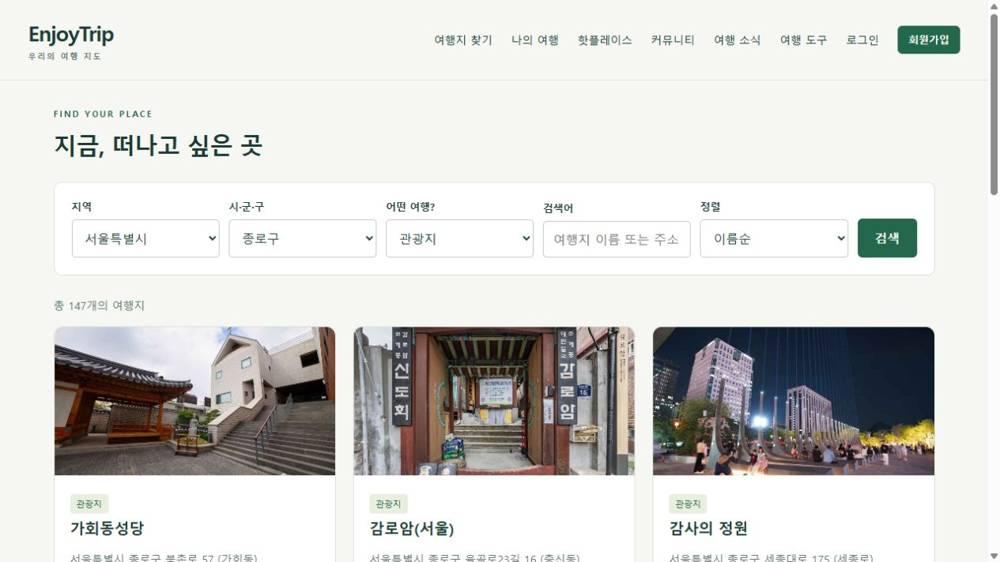
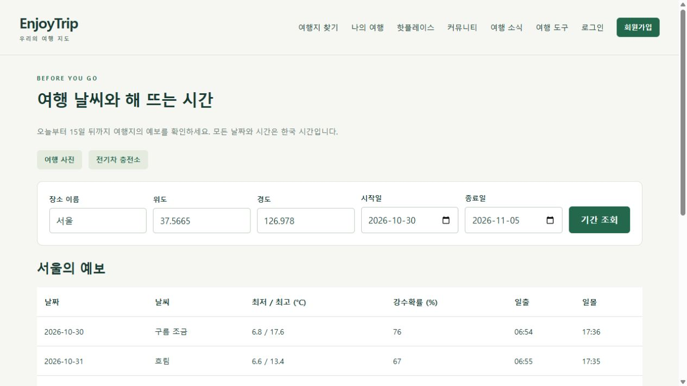
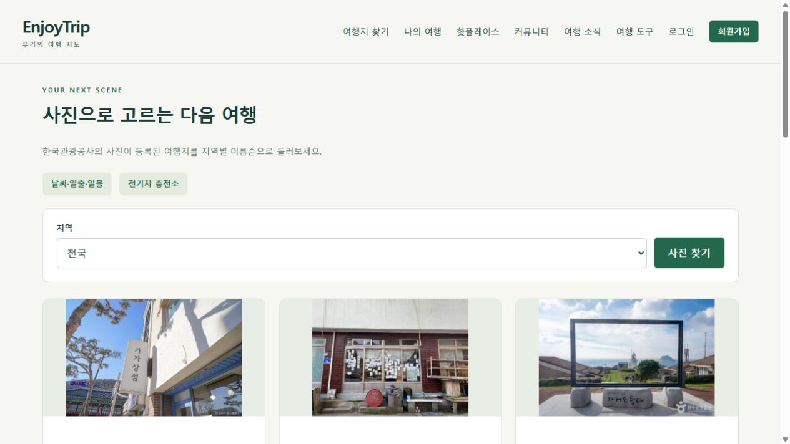
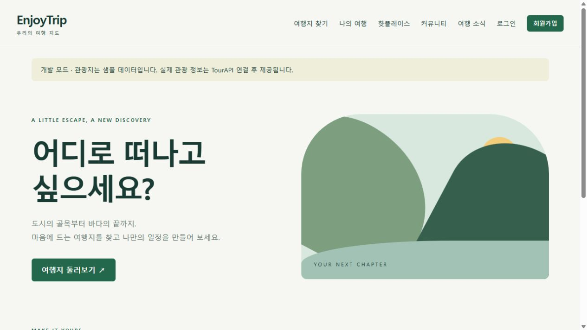
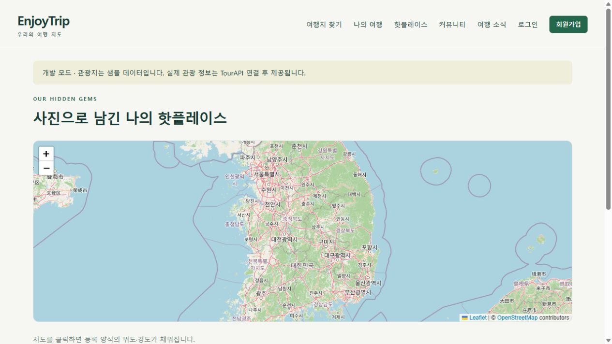
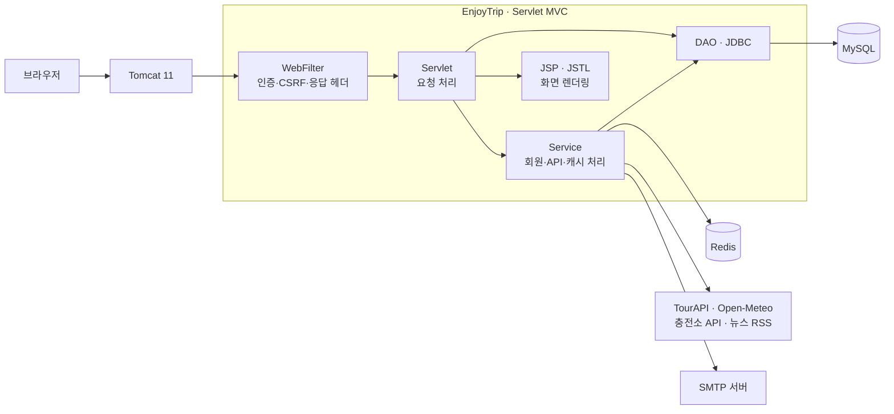

<div align="center">

# EnjoyTrip

### 여행지 탐색부터 일정과 기록까지

지역별 관광지 검색 · 나만의 여행 일정 · 사진으로 남기는 여행 기록


<a href="https://github.com/js05157/enjoytrip-portfolio/actions/workflows/ci.yml"></a>

[프로젝트 소개](#프로젝트-소개) · [실행 화면](#실행-화면) · [주요 기능](#주요-기능) · [설계와 구현](#설계와-구현) · [실행 방법](#실행-방법)

</div>



## 프로젝트 소개

**EnjoyTrip은 국내 여행지를 찾아 일정에 담고, 여행 경비와 방문 순서를 정리하며, 다녀온 장소를 사진으로 기록하는 웹 서비스입니다.** SSAFY EnjoyTrip 요구사항을 바탕으로 구현하고 개인 저장소에서 확장·관리하고 있습니다.

Servlet의 요청 처리부터 JSP 화면 렌더링, JDBC 데이터 접근까지 연결한 MVC 구조를 중심으로 구현했습니다. 여기에 실제 공공데이터 연동, 반복 조회를 위한 Redis 캐시, 세션 인증과 비밀번호 재설정, 자동화된 통합 검증을 추가했습니다.

| 항목 | 내용 |
| --- | --- |
| 프로젝트 형태 | 개인 웹 프로젝트 |
| 개발·관리 | [js05157](https://github.com/js05157) |
| 구현 범위 | Servlet/JSP 화면, 회원·일정·게시판, JDBC 데이터 접근, 외부 API·캐시 연동, 테스트·CI |
| 실행 환경 | Java 17 이상 · Tomcat 11 · WAR 배포 |
| 기반 이력 | [enjoytrip-duo/enjoytrip](https://github.com/enjoytrip-duo/enjoytrip)의 구현 커밋과 작성자 정보 보존 |

## 실행 화면

관광지 검색·날씨·사진 갤러리는 **실제 외부 API 응답**으로 확인한 화면입니다.

<table>
  <tr>
    <th width="50%">기간별 날씨와 일출·일몰</th>
    <th width="50%">사진으로 탐색하는 여행지</th>
  </tr>
  <tr>
    <td></td>
    <td></td>
  </tr>
</table>

<details>
<summary>개발 모드의 홈·핫플레이스 화면 보기</summary>

아래 두 화면은 개발용 샘플 데이터로 검증했습니다.





</details>

## 주요 기능

| 기능 | 사용자 흐름 | 구현 내용 |
| --- | --- | --- |
| 여행지 탐색 | 지역·시군구와 유형 선택 → 검색 → 상세 확인 | 법정동 코드 조회, 키워드·유형 필터, 정렬·페이지 처리, 사진·소개·지도 |
| 나의 여행 | 여행 생성 → 여행지 담기 → 방문 순서 정리 | 기간·예산·일차별 경비·메모 저장, 드래그 및 버튼 정렬, 지도 동선 |
| 여행 기록 | 사진·방문 정보 입력 → 지도와 갤러리에서 확인 | JPEG/PNG 업로드, 사진 재인코딩, 방문일·유형·설명·좌표 저장 |
| 회원·인증 | 가입 → 로그인 → 정보 관리 | 회원 CRUD, 세션 인증, POST 로그아웃, 이메일을 통한 비밀번호 재설정 |
| 커뮤니티 | 여행 이야기 작성·수정·삭제 | 작성자/관리자 권한 검사, 관리자 공지사항 CRUD |
| 여행 소식 | 수집된 뉴스 조회 → 원문 이동 | 관광 뉴스 RSS 수집, URL 중복 제거, DB 저장·페이지 처리 |
| 여행 도구 | 여행지 선택 → 날씨·사진 확인 | 최대 16일 예보, 일출·일몰 한국 시간 표시, 추가 사진·원본·공공누리 유형 |
| 전기차 충전소 | 지역 선택 → 충전기 위치·상태 확인 | 지도·유형·용량·상태 갱신 시각·페이지 처리 구현, 실제 API 재검증 대기 |

요구사항 번호별 구현 범위와 선택 사항은 [요구사항 문서](docs/requirements.md)에 정리했습니다.

## 기술 스택

| 구분 | 기술 | 사용 목적 |
| --- | --- | --- |
| Backend | Java 17, Jakarta Servlet 6.1 | 요청·응답, 세션, 필터와 컨텍스트 수명주기 관리 |
| Frontend | JSP, JSTL, JavaScript, CSS | 서버 렌더링, 입력·오류 안내, 드래그 정렬, 반응형 화면 |
| Database | MySQL 8, JDBC, HikariCP | 회원·일정·게시글·사진 메타데이터 영속화와 커넥션 풀 |
| Cache | Redis 8.2, Jedis | 관광지·날씨·충전소 응답 캐시와 장애 시 우회 |
| Map | Leaflet 1.9.4, OpenStreetMap | 여행지·동선·핫플레이스·충전소 위치 표시 |
| External | TourAPI, Open-Meteo, 관광 뉴스 RSS, SMTP | 관광 정보·날씨·사진·뉴스·재설정 메일 연동 |
| Build / Test | Maven Wrapper, JUnit 5, H2, 로컬 HTTP·SMTP 응답 서버 | WAR 빌드, 단위·계약·통합 검증 |
| Runtime / CI | Tomcat 11, Docker Compose, GitHub Actions | 로컬 실행 환경과 MySQL·Redis 기반 자동 검증 |

실제 의존성 버전은 [pom.xml](pom.xml), 실행 조합은 [환경 설정 문서](docs/setup.md)에서 확인할 수 있습니다.

## 시스템 구조



회원·일정·게시글 등 영구 데이터는 MySQL에 저장하고, 외부 조회 응답은 Redis에 TTL을 두어 저장합니다. 업로드 이미지는 웹 루트 밖에 보관하며 JSP는 Servlet이 전달한 데이터를 출력합니다.

[클래스 구조·ERD 상세 보기 →](docs/architecture.md)

## 설계와 구현

### 1. 조회 조건 전체를 구분하는 Redis 캐시

같은 관광지 조회를 반복할 때 외부 API를 다시 호출하지 않도록 `Cache-Aside` 방식으로 구성했습니다. **지역·시군구·유형·검색어·페이지·크기·정렬**과 `demo/live` 모드를 구분해 다른 조회 조건의 결과가 섞이지 않도록 했습니다.

```text
관광지 조회 → Redis GET
  ├─ 캐시 적중 → 저장된 응답 반환
  └─ 캐시 미적중 → TourAPI 조회 → Redis SET EX → 응답 반환
```

| 대상 | TTL | 실패 처리 |
| --- | --- | --- |
| 관광지 목록 | 600초 | Redis 연결 실패 시 원본 API 조회 |
| 날씨·일출·일몰 | 1,800초 | 제공기관 오류 응답은 캐시하지 않음 |
| 충전소 | 60초 | 제공기관 오류 응답은 캐시하지 않음 |

- 관광지 캐시 키는 조회 조건을 JSON으로 직렬화한 뒤 SHA-256으로 생성합니다.
- Redis 연결 제한은 300ms이며, 연결 실패 후 5초 동안 캐시 접근을 우회합니다.
- 인증키를 포함한 외부 API 요청 URL은 해시로 구분하고 캐시 키·오류 메시지에 노출하지 않습니다.
- 실제 Redis에서 저장·조회·TTL 만료를 검증하고 `/health`에서 캐시 적중·미적중 횟수를 확인했습니다.

구현: [CachedAttractionService](src/main/java/com/enjoytrip/cache/CachedAttractionService.java) · [RedisCache](src/main/java/com/enjoytrip/cache/RedisCache.java) · [JsonApi](src/main/java/com/enjoytrip/common/JsonApi.java)

### 2. 본인 데이터와 재설정 토큰을 보호하는 인증 흐름

비밀번호는 무작위 salt와 **PBKDF2-HMAC-SHA256 600,000회**로 해시합니다. 재설정 토큰은 원문 대신 SHA-256 해시를 DB에 저장하며 **15분 만료·1회 사용**을 적용했습니다. 비밀번호 변경 시 세션 버전을 올려 다른 세션을 무효화합니다.

POST 요청에는 CSRF 검사를 적용하고, 일정·게시글 변경 시 소유권 또는 관리자 권한을 검사합니다. 사진은 업로드 후 재인코딩하며 저장 경로를 제한합니다.

구현: [Passwords](src/main/java/com/enjoytrip/member/Passwords.java) · [ResetService](src/main/java/com/enjoytrip/member/ResetService.java) · [WebFilter](src/main/java/com/enjoytrip/common/WebFilter.java) · [ImageStore](src/main/java/com/enjoytrip/place/ImageStore.java)

### 3. 방문 순서 저장에서 데이터 일관성 확인

여행지를 정렬할 때 전달된 ID 목록이 해당 일정의 실제 여행지 목록과 같은지 확인합니다. 중복·누락·다른 일정의 ID가 있으면 변경을 거부하고, 순서 갱신은 트랜잭션으로 처리합니다.

지도는 저장된 방문 순서를 연결해 보여줍니다. 일차별 순서를 관리하며 도로 길찾기·이동 시간 계산은 제공 범위에 포함하지 않습니다.

구현: [PlanDao](src/main/java/com/enjoytrip/plan/PlanDao.java) · [일정 화면](src/main/webapp/WEB-INF/views/plans/detail.jsp)

## 트러블슈팅

<details>
<summary><strong>관광지 지역 검색을 최신 법정동 코드로 전환</strong></summary>

**문제** — 기존 지역 코드 조회 방식은 폐기 예정 항목에 의존하고 있었습니다.

**조치** — 지역·시군구 목록을 `ldongCode2`로 조회하고, 검색 요청은 `lDongRegnCd`·`lDongSignguCd`로 전환했습니다. 이미지 조회에서도 미지원 요청 변수를 제외했습니다.

**확인** — 실제 API와 브라우저에서 서울 → 종로구 선택 시 목록이 해당 지역으로 좁혀지는 것을 확인했습니다. 로컬 계약 테스트로 요청 변수도 검증합니다.

</details>

<details>
<summary><strong>단위 테스트는 통과했지만 충전소 JSP에서 500 오류 발생</strong></summary>

**문제** — 충전소 데이터가 있을 때 `${charger.hasCoordinates}`를 처리하는 JSP에서 속성 조회 오류가 발생했습니다.

**원인** — Tomcat 11의 record EL 접근에서 계산 속성에 대응하는 `hasCoordinates()` 메서드가 필요했습니다.

**조치·확인** — 해당 메서드를 추가하고, 충전소 데이터를 반환하는 로컬 HTTP 서버와 실제 Tomcat을 연결해 지도·상태 화면을 다시 검증했습니다. 이 시나리오를 CI에 포함했습니다.

</details>

<details>
<summary><strong>외부 API 인증 실패를 진단할 수 있도록 오류 정보 보완</strong></summary>

**문제** — 공통 오류 안내만으로는 제공기관이 반환한 HTTP 상태와 인증 오류를 구분하기 어려웠습니다.

**조치** — HTTP 상태와 숫자 오류코드를 표시하고, 인증키·원본 요청 URL·응답 본문의 민감한 내용은 노출하지 않도록 했습니다. 실패 응답도 캐시에서 제외했습니다.

**확인** — 현재 충전소 API의 `HTTP 403 / 코드 30`을 화면에서 확인할 수 있습니다. 원인 상태를 추측해 정상 처리하지 않고 실제 API 재검증 대상으로 기록했습니다.

</details>

## 테스트와 검증

**단위·계약·실제 Redis 통합 테스트 25개 통과**를 확인했습니다. GitHub Actions에서는 JDK 17·MySQL 8.4·Redis 8.2·Tomcat 11로 WAR 빌드와 HTTP 시나리오를 실행합니다.

| 검증 대상 | 확인 내용 |
| --- | --- |
| TourAPI 계약 | 요청 변수·인코딩, 단일/빈 응답 처리, 숫자 오류코드와 키 노출 차단 |
| 캐시 | 조건별 키 분리, 적중·손상 복구, 실제 Redis 저장·TTL 만료 |
| 회원·인증 | 회원 CRUD, CSRF, 세션, 재설정 토큰 교체·재사용 차단, 로컬 SMTP 전송 |
| 여행 일정·게시판 | 다른 회원 데이터 접근 차단, 정렬 목록 검사, 작성 권한·출력 이스케이프 |
| 이미지·뉴스 | 재인코딩·경로 제한, RSS 파싱·안전하지 않은 링크 제외, XML 외부 엔티티 차단 |
| 여행 도구 | 날짜·좌표 검사, 한국 시간 표시, 사진·충전소 JSP 응답 |

캐시는 기능 동작과 실패 처리까지 검증했으며, 부하 테스트를 통한 응답 시간 개선율은 아직 측정하지 않았습니다.

[자동 검사 결과 →](https://github.com/js05157/enjoytrip-portfolio/actions) · [환경별 검증 기록 →](docs/verification.md)

## 실행 방법

JDK 17 이상을 설치한 Windows 환경 기준입니다. API 키 없이 화면과 회원·일정 기능을 확인할 수 있는 개발 모드를 제공합니다.

```powershell
git clone https://github.com/js05157/enjoytrip-portfolio.git
cd enjoytrip-portfolio

# Redis 실행 — Docker Desktop 실행 환경 필요
docker compose up -d

# 빌드·검증 후 로컬 Tomcat 실행
.\scripts\run-local.ps1
```

접속 주소는 **http://localhost:8080/enjoytrip/** 입니다. 개발 모드는 샘플 관광지와 파일 H2 DB를 사용하고, 화면에 개발 모드를 표시합니다. Redis가 없어도 원본 조회로 동작합니다. 날씨는 외부 네트워크 연결이 필요합니다.

실제 MySQL·TourAPI·SMTP 연결은 `config/application-local.properties.example`을 개인 설정 파일로 복사해 입력합니다. 개인 파일은 Git에서 제외하며, 설정을 바꾼 뒤 서버를 재시작합니다.

[MySQL·API·SMTP 설정, 포트 변경, 검증 명령 →](docs/setup.md)

## 확인이 남은 부분

| 항목 | 현재 확인된 범위 | 남은 확인 |
| --- | --- | --- |
| 충전소 API | 응답 파싱·지도·상태 화면·오류 처리를 로컬 HTTP 응답 서버로 검증 | 실제 서비스는 마지막 호출에서 `403 / 코드 30` 반환. 등록 상태 확인 후 정상 데이터 재검증 |
| 비밀번호 재설정 | 로컬 SMTP/HTTP 흐름, Gmail 인증, 본인 주소 테스트 메일 발송·실제 수신 | 실제 재설정 메일의 링크 → 변경 → 로그인 전체 흐름 |

## 문서와 코드

| 문서 | 내용 |
| --- | --- |
| [요구사항](docs/requirements.md) | F101~F114와 비기능 요구사항의 구현 범위 |
| [Usecase](docs/usecases.md) | 사용자·관리자와 외부 서비스의 기능 관계 |
| [클래스 구조·ERD](docs/architecture.md) | MVC 구성, 테이블 관계와 데이터 보호 방식 |
| [실행·설정](docs/setup.md) | 로컬 실행과 개인 설정, Redis 확인, 테스트 명령 |
| [검증 기록](docs/verification.md) | 실제 연동·로컬 응답 테스트의 범위와 결과 |

<details>
<summary>프로젝트 디렉터리 보기</summary>

```text
src/main/java/com/enjoytrip/
├── common/       공통 설정·DB·필터·앱 수명주기
├── attraction/   관광지 검색·상세·사진·지역 코드
├── cache/        Redis 캐시와 조회 조건별 키
├── member/       회원·인증·비밀번호 재설정
├── plan/         여행 일정·경비·방문 순서
├── place/        이미지 저장·핫플레이스
├── community/    공지·공유게시판
├── news/         뉴스 RSS 수집·저장
└── travel/       날씨·일출일몰·사진·충전소

src/main/webapp/WEB-INF/views/   JSP 화면
src/main/resources/db/         DB 스키마
src/test/                      단위·계약·통합 테스트
scripts/                       실행·HTTP 검증 스크립트
.github/workflows/             CI
```

</details>

관광 정보·사진은 [한국관광공사 TourAPI](https://www.data.go.kr/tcs/dss/selectApiDataDetailView.do?publicDataPk=15101578), 날씨·일출일몰은 [Open-Meteo](https://open-meteo.com/), 지도는 [Leaflet](https://leafletjs.com/)과 [OpenStreetMap](https://www.openstreetmap.org/copyright)을 사용합니다. 사진별 이용 조건을 화면에 표시하며, 뉴스는 제목·출처·원문 링크를 저장합니다. Leaflet 라이선스는 저장소에 포함되어 있습니다.
