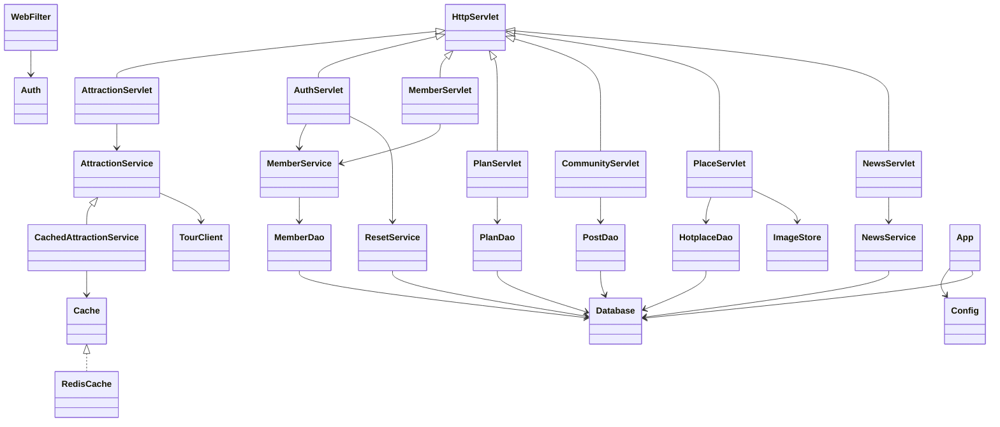
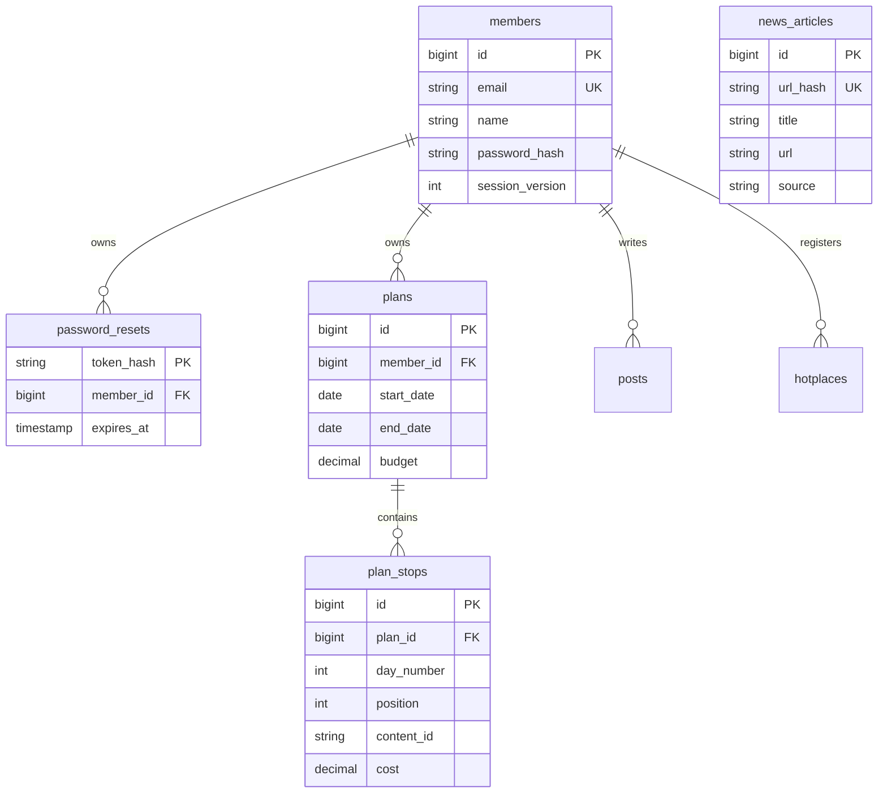

# MVC 구조와 데이터 설계

Servlet은 요청/응답·화면 전달, Service는 회원·API·캐시 처리, DAO는 JDBC 접근, JSP는 출력만 담당합니다. 소규모 일정·게시판의 입력 검사는 Servlet, 데이터 소유권 검사는 DAO에서도 수행합니다. 앱 단위 공유 자원(HikariCP/JedisPool)은 `App` 리스너가 생성/종료합니다.

정확한 DDL은 `src/main/resources/db/schema.sql`입니다. 계정 삭제 시 FK CASCADE로 개인 DB 데이터가 삭제되고 업로드 사진도 정리합니다.

비밀번호는 무작위 salt와 PBKDF2-HMAC-SHA256 600,000회로 해시합니다. 재설정 토큰은 SHA-256 해시만 DB에 저장하고 15분 만료·트랜잭션 기반 1회 사용을 적용합니다. 비밀번호 변경 시 `session_version`을 올려 다른 세션을 무효화합니다. POST에는 CSRF 토큰이 필요하며, 사용자 출력은 JSTL `c:out`으로 이스케이프합니다.
