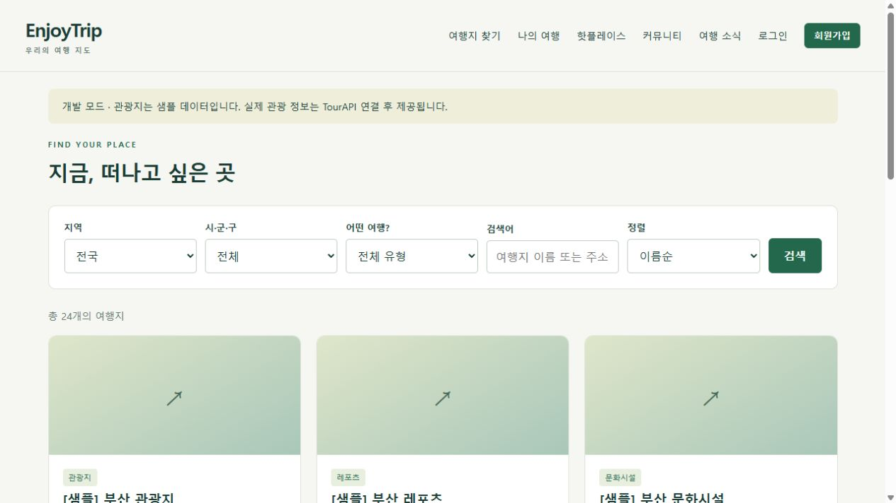

# 검증 결과

검증일: **2026-10-30 (Asia/Seoul)**

## 실행한 검증

| 대상 | 결과 |
| --- | --- |
| Maven `verify` / WAR 빌드 | 성공 |
| JUnit 16개 | 실패 0, 오류 0, 스킵 0 (실제 Redis 포함) |
| MySQL 8.0.46 + Tomcat 11.0.27 HTTP 시나리오 | 성공 |
| Redis 8.2.11 저장·조회·TTL 만료 | 성공 |
| 같은 관광지 조건 재조회 | 캐시 hits 증가 확인 |
| TourAPI 버전 2 엔드포인트·단일/빈 응답·키 인코딩 | 로컬 HTTP 계약 테스트 성공 |
| 회원 가입·조회·수정·탈퇴 / 잘못된 비밀번호 | 성공 |
| CSRF 누락·다른 회원 일정 접근 / 게시글 수정 권한 | 차단 확인 |
| 사진 업로드·JPEG 재인코딩·탈퇴 시 파일 정리 | 성공 |
| 재설정 토큰 재사용·이전 토큰 / 세션 버전 변경 | 차단 및 변경 확인 |
| SMTP 전송 | 로컬 SMTP 수신 서버로 MIME 메일 전달 확인 |
| 실제 관광 뉴스 RSS 수집·DB 저장 | HTTP 200 및 새 기사 저장 확인 |
| Windows 로컬 실행 스크립트 | Tomcat 다운로드·체크섬·배포·기동 확인 (18082 포트) |
| JSP 한글·목록·OpenStreetMap 지도 타일 | 브라우저 시각 검증 완료 |
| JavaScript / PowerShell 구문 / Git whitespace | 통과 |

HTTP 시나리오는 `scripts/smoke_test.py`로 재현할 수 있습니다. 테스트 회원 두 명을 생성하고 검증 후 삭제합니다. 기존 로컬 MySQL 서비스는 변경하지 않고, 별도 데이터 디렉터리·33307 포트의 테스트 인스턴스에서 검증했습니다.

## 별도 환경 설정이 필요한 항목

- 개인 TourAPI 키가 아직 개인 설정 파일에 입력되지 않아 실제 키를 사용한 TourAPI 호출은 검증하지 않았습니다. 요청·응답 형태는 로컬 계약 테스트로 확인했습니다.
- 실제 메일 계정의 인증/STARTTLS 연결과 수신함 도착은 개인 SMTP 설정 후 확인해야 합니다. 로컬 SMTP 프로토콜 전송 경로는 검증했습니다.
- 이 PC의 Docker Desktop이 기존 시작 오류를 반환하여 Compose 기동은 확인하지 못했습니다. 실제 Redis는 공식 Redis 이미지의 실행 파일로 별도 실행해 검증했습니다. 일반적인 실행은 README의 Docker Compose 방식을 사용합니다.
- GitHub Actions는 JDK 17·MySQL 8.4·Redis 8.2 환경에서 동일한 빌드/HTTP 검증을 수행하도록 구성했습니다. 실행 결과는 저장소 Actions 탭에서 확인합니다.

## 실행 화면

화면의 관광지는 개발용 샘플로 표시되어 있습니다. 실제 관광 정보 화면은 live 모드와 TourAPI 설정 후 사용합니다.
